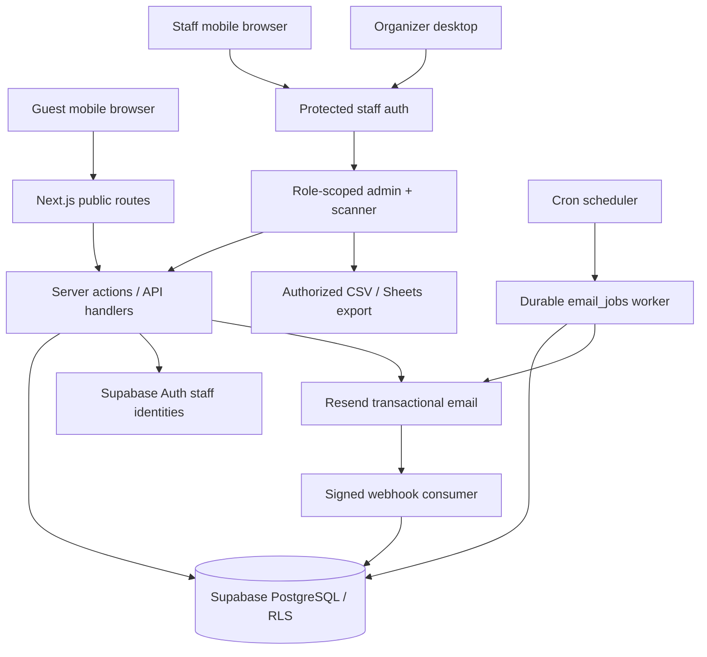

# 10 — Technical architecture, components and deployment

## Recommended stack
- Web app: Next.js App Router + TypeScript (strict) + Tailwind CSS, one repository, SSR where appropriate.
- Database: managed PostgreSQL via Supabase with schema migrations, row-level security and typed queries.
- Staff/auth: Supabase Auth manages credentials and session, plus **server-only username mapping** for requested username+password UX; active memberships authorize org/event scopes.
- Guest verification: custom purpose-limited single-use email verification token flow, with no guest password/account requirement (a separate server-side flow from admin authentication).
- Email delivery: Resend transactional API, signed delivery webhooks, server-side mail adapter + durable queue/idempotency. Provider can change via adapter.
- QR decoding: maintained camera-based library; server handles authorization and atomic check-in.
- Hosting: Next.js on a platform supporting HTTPS and server functions (e.g. Vercel). Background ticket dispatch using scheduled cron + reliable DB job claiming or provider equivalent.
- Tests: Vitest (logic), Playwright (E2E + browser), database integration, concurrency tests and optional CI on GitHub Actions.
- Export: CSV/Excel-compatible in MVP; optional later Google Sheets synchronization.

## Diagram


## Architecture invariants
1. No direct public endpoint can read a list of guests or active tickets. Public actions are scoped by invite code/verification token and rate-limited.
2. Client-side React state is **not** a source of truth for invite usage, seat cap, ticket check-ins or staff authorization.
3. Every check-in and quota change uses a DB transaction and constraints to handle concurrent users.
4. Admin/staff account provisioning is private; no public `/signup` for staff.
5. Use migrations and service adapters. `.env.local` remains local and uncommitted; `.env.example` uses placeholders only.
6. Deploy staging before production; never test email sending or scanner with unconsenting real guests.

## Example repository structure (after Codex Phase 0)
```text
night-life-event/
  AGENTS.md
  README.md
  docs/
  src/
    app/
      (public)/
      staff/login/
      staff/scanner/
      admin/
      api/
    components/
      ui/
      guest/
      admin/
      scanner/
    lib/
      auth/
      db/
      mail/
      qr/
      validation/
      metrics/
  supabase/
    migrations/
    seed.sql
  tests/
    unit/
    integration/
    e2e/
  .env.example
  IMPLEMENTATION_LOG.md
```

## Architecture choices to validate during implementation
- SSR sessions for Next.js Auth with current supported Supabase SDK (`@supabase/ssr` or successor).
- Secure username mapping without account enumeration and with server-only table access. Do not create bespoke password hashing.
- Where scheduled workers run and how they atomically claim jobs; verify provider limits and duplicate prevention.
- Signed transactional email webhook handling and provider delivery state semantics.
- Current maintained scanner library on iOS Safari, Android Chrome, secure context, automatic rear camera selection and permission UX.
- Event-local scheduling across DST/ambiguous times.

## Suggested environment variables (names placeholders, final names to be checked)
```
NEXT_PUBLIC_APP_URL=https://your-staging-domain.example
NEXT_PUBLIC_SUPABASE_URL=...
NEXT_PUBLIC_SUPABASE_PUBLISHABLE_KEY=...
SUPABASE_SECRET_KEY=...
RESEND_API_KEY=...
MAIL_FROM=no-reply@your-verified-domain.example
CRON_AUTH_SECRET=...
```
Never set real values in repository markdown, screenshots or shared prompts. Supabase's *publishable* key may be public but does not make open table permissions safe; service role/secret key must remain server-side.

## Deployment order
Phase 0 local UI -> Phase 1 schema/test DB -> Phase 2 staff auth -> Phase 3 guest verification+RSVP -> Phase 4 emails/tickets -> Phase 5 scanner/checkin -> Phase 6 analytics/export -> staging end-to-end -> production pilot. Product milestones can be rearranged only with a written test plan.

## Observability
Structured backend logs without PII/secrets; failed email dashboard, job processing counts, response latency, scan failures, auth failures, migration version and deploy version. Backups and a documented restore test required before the first real event.
